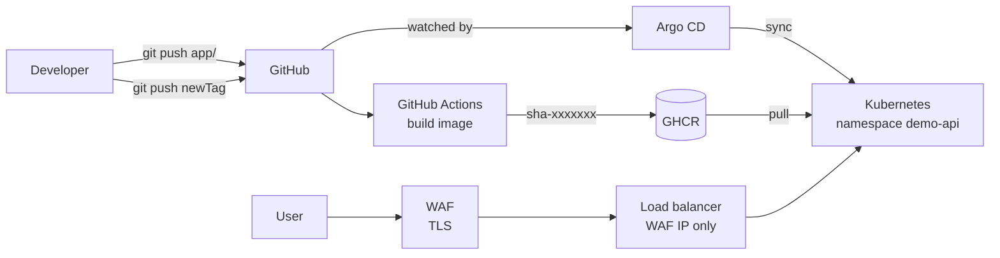

# gitops-k8s-lab

A GitOps lab on Kubernetes: a small API is built by GitHub Actions, shipped by Argo CD and run with production-style
hardening. The app is deliberately trivial; the repository is about **how it is delivered and operated**.

Based on a setup I run on a Kubernetes cluster on OpenStack. Nothing here is OpenStack-specific except the
`LoadBalancer` Service, which any cloud provider implements.

## What it demonstrates

| Area | What is in the repo |
|---|---|
| CI | GitHub Actions builds the image and pushes it to GHCR tagged with the commit SHA (`sha-xxxxxxx`) |
| CD / GitOps | Argo CD Applications with automated sync, `prune` and `selfHeal`; Git is the only source of truth |
| Configuration | Kustomize `base` + `overlays`; generated ConfigMaps, so a config change triggers a rollout |
| Promotion and rollback | Change one tag in Git to deploy; `git revert` to roll back |
| Secrets | Sealed Secrets: secrets live in Git encrypted, only the cluster can decrypt them |
| Disaster recovery | Weekly CronJob backs up the Sealed Secrets keys to S3, encrypted with a public certificate |
| Hardening | Pod Security `restricted`, non-root, read-only root filesystem, dropped capabilities, seccomp, no API token |
| Reliability | Readiness and liveness probes, resource requests and limits |
| Network exposure | `LoadBalancer` restricted to the WAF egress IP; `X-Forwarded-For` trusted only from cluster nodes |
| Least privilege | Namespaced `Role` for the backup job instead of a `ClusterRole` |

## Flow



## Layout

```
app/                          the demo API (FastAPI) and its Dockerfile
.github/workflows/build.yml   CI: build and push the image
apps/demo-api/
├── base/                     what the app IS (valid for any environment)
└── overlays/lab/             what changes in the lab: image tag, WAF exposure, trusted proxy range
apps/sealed-secrets-backup/   CronJob that backs up the Sealed Secrets keys to S3
argocd/                       the Argo CD Applications
```

## Prerequisites

- A Kubernetes cluster (1.29+) with a `LoadBalancer` implementation
- [Argo CD](https://argo-cd.readthedocs.io/en/stable/getting_started/) installed in the `argocd` namespace
- `kubectl`, and `kubeseal` if you use the Sealed Secrets parts

If you fork this repository, replace `carriel2` in the image name and in the `repoURL` fields with your own account.

## Getting started

**1. Build the image.** Push any change under `app/` (or run the workflow manually). The workflow summary prints the
tag, for example `sha-1a2b3c4`. Make the GHCR package public, or add an `imagePullSecret`.

**2. Set the tag** in `apps/demo-api/overlays/lab/kustomization.yaml` (`newTag`), then commit and push.

**3. Adjust the two environment values** in the overlay:

- `service-lb.yaml`: `loadBalancerSourceRanges` must be your WAF egress IP (the committed value is a documentation
  address and matches nothing).
- `forwarded-ips.yaml`: the CIDR must be your cluster's node subnet.

**4. Register the Application.** From here on Argo CD does the rest:

```bash
kubectl apply -f argocd/demo-api-app.yaml
```

**5. Test** through a tunnel (the base Service is internal):

```bash
kubectl port-forward -n demo-api svc/demo-api 8081:80
curl -s localhost:8081/
```

## Day-to-day operations

- **Ship a version:** change `newTag`, commit, push. Argo CD applies it with a rolling update.
- **Roll back:** `git revert` that commit. With automated sync on, Git is the rollback mechanism; the rollback button
  in the Argo CD UI is disabled by design.
- **Change configuration:** edit the `configMapGenerator` literals. The ConfigMap name changes, so pods are replaced.
- **Drift:** change something by hand in the cluster and watch `selfHeal` revert it.

## Secrets with Sealed Secrets (optional)

```bash
kubectl apply -f argocd/sealed-secrets-app.yaml

kubectl create secret generic demo-api-env -n demo-api \
  --from-literal=APP_SECRET_TOKEN=change-me --dry-run=client -o yaml \
  | kubeseal --controller-namespace sealed-secrets --format yaml \
  > apps/demo-api/base/sealed-demo-api-env.yaml
```

Uncomment `sealed-demo-api-env.yaml` in `apps/demo-api/base/kustomization.yaml`, commit and push. `GET /` then
returns `"secret_loaded": true`. The encrypted file is safe to keep in a public repository: only the controller in
your cluster can decrypt it.

The keys that make this possible must be backed up: see
[apps/sealed-secrets-backup](apps/sealed-secrets-backup/README.md).

## Exposure behind a WAF

The `lab` overlay adds a second Service, `demo-api-lb` (`type: LoadBalancer`). `loadBalancerSourceRanges` limits it
to the WAF egress IP, so any other source is refused **at the load balancer**, before reaching the cluster.

Check the restriction from a machine that is not the WAF (expect a timeout or a refusal, never an app response):

```bash
kubectl get svc demo-api-lb -n demo-api
curl -m 8 -sS -o /dev/null -w "%{http_code}\n" http://<LOAD-BALANCER-IP>/health
```

### Real client IP

Behind the WAF and the load balancer the pod sees a **node** IP as the peer. The client IP only exists in the
`X-Forwarded-For` header added by the WAF. uvicorn trusts that header only when the connection comes from the node
subnet (`--forwarded-allow-ips`, set in `overlays/lab/forwarded-ips.yaml`), so a header forged by a pod or by any
other address is ignored. `GET /whoami` shows what the app sees.

Residual risk: a machine on the private network that can reach the NodePort could forge the header. A
`NetworkPolicy` closes that gap.

## Troubleshooting

| Symptom | Likely cause |
|---|---|
| `ImagePullBackOff` | Wrong `newTag`, or the GHCR package is still private |
| Pod rejected at admission | The manifest violates Pod Security `restricted` |
| `readinessProbe failed` | The app is still starting, or `/health` is not reachable on the `http` port |
| Application `OutOfSync` after a manual change | Expected: `selfHeal` reverts it within a few minutes |
| `/whoami` shows a `10.x` address | The node subnet in `forwarded-ips.yaml` does not cover the node that forwarded the request |

## Roadmap

- Progressive delivery with Argo Rollouts (canary with automated analysis)
- Metrics with Prometheus and dashboards in Grafana
- `NetworkPolicy` for the `demo-api` namespace
